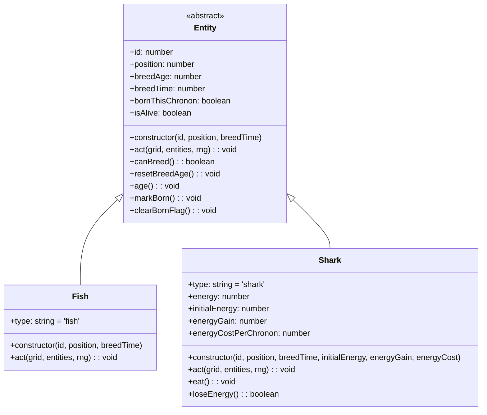
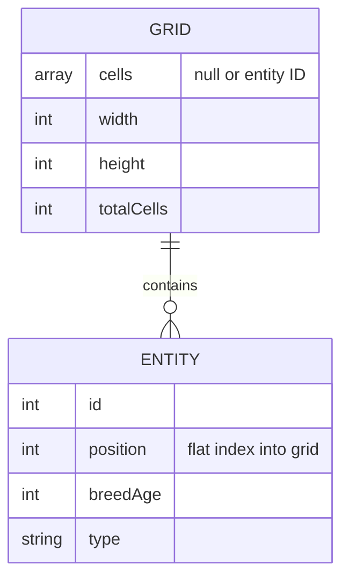
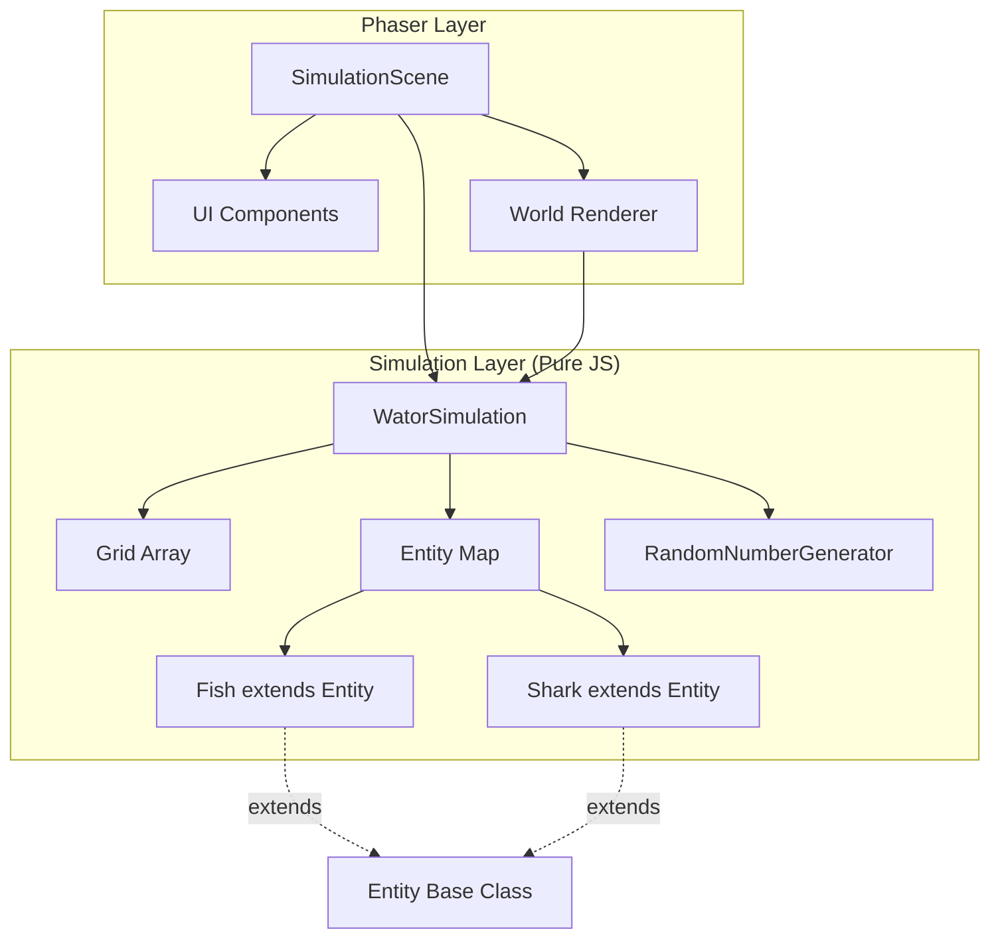
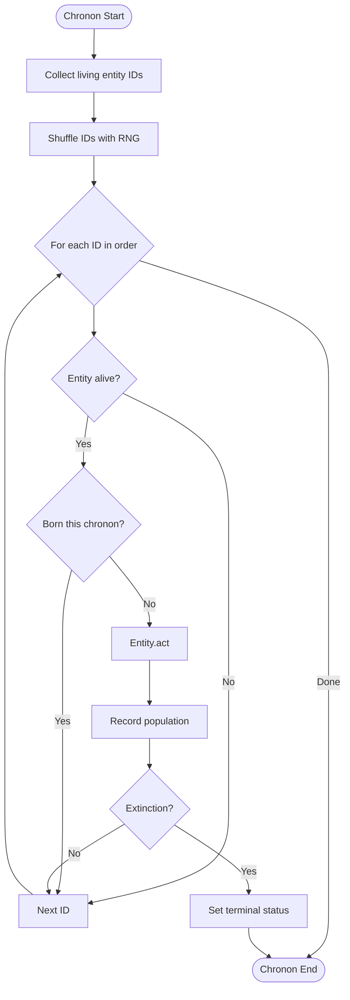
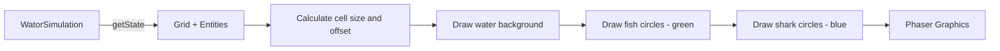
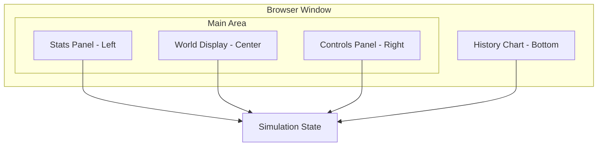
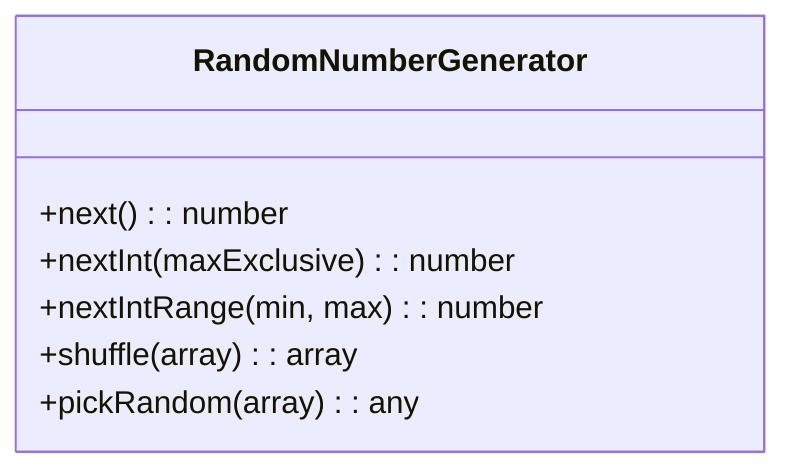
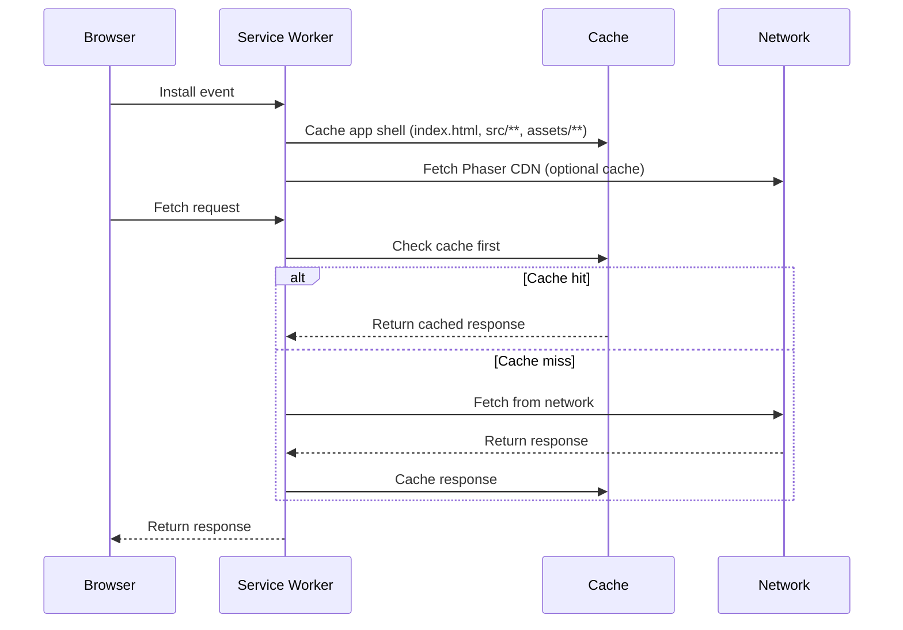

# Design

## Context

This is a greenfield project creating a browser-based Wa-Tor predator-prey simulation. The project already has:
- `src/ui/PhaserButton.js` - A complete Phaser-native button component
- `assets/icon-192.png` and `assets/icon-512.png` - PWA icons
- `prd-v001.md` - Detailed product requirements
- OpenSpec initialized with spec-driven schema

The simulation must be completely independent of Phaser, with Phaser used only for rendering and input. The app is a static site with no build step, using ES2020 modules and Phaser 4 loaded from CDN.

## Goals / Non-Goals

**Goals:**
- Clean separation between simulation engine (pure JavaScript) and rendering (Phaser)
- Object-oriented design with `Entity` base class and `Fish`/`Shark` subclasses
- Responsive layout that works on desktop and tablet (minimum 744x1133 CSS pixels)
- PWA support with offline capability after first load
- All constants easily configurable in a single config module

**Non-Goals:**
- No build tooling, TypeScript, or backend services
- No automated tests
- No user-facing controls for grid dimensions or simulation parameters
- No seeded random number support (uses `Math.random()`)
- No keyboard shortcuts, world editing, or debug features

## Decisions

### Decision 1: Class Hierarchy for Entities

**Choice:** Use an abstract `Entity` base class with `Fish` and `Shark` subclasses.

**Rationale:** The PRD explicitly requires object-oriented design with entities as class instances extending a common base class. This enables polymorphic behavior where each entity type decides its own action.

**Alternatives considered:**
- Single `Entity` class with type field: Simpler but less extensible and doesn't demonstrate OOP
- Composition over inheritance: More flexible but overkill for this fixed two-type system

**Class Diagram:**



### Decision 2: Grid Representation

**Choice:** Flat array with one slot per cell, storing entity ID or `null` for empty.

**Rationale:** PRD requirement #27 specifies a flat grid array. This is cache-friendly and simple to index. Entity position is stored as the flat array index.

**Alternatives considered:**
- 2D array: More intuitive but less cache-friendly and requires nested indexing
- Map of position to entity: More flexible but slower for neighbor lookups

**Grid Structure:**



### Decision 3: Simulation Engine Architecture

**Choice:** `WatorSimulation` class owns the grid, entity map, and simulation state. Completely Phaser-independent.

**Rationale:** PRD requirement #4 mandates simulation independence from Phaser. This enables testing without a browser and clean separation of concerns.

**Architecture:**



### Decision 4: Chronon Execution Flow

**Choice:** Collect living entity IDs, shuffle with single RNG, process each in order with skip logic for dead/newborn entities.

**Rationale:** PRD requirements #11-13 specify this exact flow. Using entity IDs (not references) in the turn order allows detecting when an entity has been eaten.

**Flow Diagram:**



### Decision 5: Rendering Strategy

**Choice:** Single Phaser `Graphics` object for the world, redrawn completely each frame. No sprites, no animation.

**Rationale:** PRD requirements #28-29, #50 specify Graphics rendering with immediate updates. For a 100x70 grid (7000 cells), full redraw is performant enough.

**Rendering Pipeline:**



### Decision 6: UI Component Architecture

**Choice:** Separate UI component classes for StatsPanel, ControlsPanel, SpeedControls, and HistoryChart, all using Phaser-native rendering.

**Rationale:** PRD requirements #30-33, #44-47 specify distinct UI areas. Separate classes enable independent layout and updates.

**UI Layout:**



### Decision 7: Speed Control Implementation

**Choice:** Time accumulator in `SimulationScene.update()` that triggers simulation steps based on selected speed.

**Rationale:** PRD requirement #48 specifies speed-based advancement during Phaser update frames. Accumulator pattern handles variable frame rates smoothly.

**Speed Table:**
| Speed | Chronons/sec | Interval (ms) |
|-------|-------------|---------------|
| 1x    | 1           | 1000          |
| 5x    | 5           | 200           |
| 10x   | 10          | 100           |
| 30x   | 30          | 33.33         |
| 60x   | 60          | 16.67         |

### Decision 8: Single RNG Source

**Choice:** `RandomNumberGenerator` class wrapping `Math.random()` with methods for common operations.

**Rationale:** PRD requirement #61 mandates exactly one RNG for all random choices. Wrapper class provides clean API and single point of control.

**RNG Interface:**



### Decision 9: File Organization

**Choice:** Organized by concern with clear separation between simulation, scenes, and UI.

**Rationale:** PRD requirement #2 specifies exact file structure. This organization supports the separation of concerns.

**File Structure:**

```
src/
├── main.js                    # Phaser game config, entry point
├── config.js                  # Config class with all constants
├── simulation/
│   ├── WatorSimulation.js     # Core simulation engine
│   ├── Entity.js              # Abstract base entity class
│   ├── Fish.js                # Fish entity implementation
│   ├── Shark.js               # Shark entity implementation
│   └── RandomNumberGenerator.js  # Single RNG wrapper
├── scenes/
│   ├── BootScene.js           # Preload, transition to simulation
│   └── SimulationScene.js     # Main game scene, orchestrates everything
└── ui/
    ├── PhaserButton.js        # Button component (exists)
    ├── StatsPanel.js          # Population stats display
    ├── ControlsPanel.js       # Play/Pause/Step/Reset buttons
    ├── SpeedControls.js       # Speed selector buttons
    └── HistoryChart.js        # Population history chart
```

### Decision 10: PWA Implementation

**Choice:** Basic service worker caching app shell, manifest with existing icons.

**Rationale:** PRD requirements #56-57 specify lightweight PWA support. Phaser from CDN limits guaranteed offline behavior.

**Service Worker Strategy:**



## Risks / Trade-offs

| Risk | Mitigation |
|------|------------|
| Phaser CDN unavailable | Document network requirement for first load; service worker caches after first successful load |
| Full redraw performance at 60x speed | 7000 cells is small enough for 60fps redraw; profile if issues arise |
| No automated tests | Careful implementation with manual browser verification; clear acceptance criteria in PRD |
| Fixed UI constants | All constants in `config.js` for easy modification |
| `Math.random()` not seedable | Accept limitation per PRD; no reproducible runs required |
| Browser throttling when hidden | Accept per PRD requirement #49; no catch-up compensation |

## Migration Plan

Not applicable - this is a new project with no existing code to migrate.

## Open Questions

- Exact pixel sizes for UI elements (fonts, button dimensions, spacing) - will be determined during implementation based on visual balance
- Specific color values for fish (green), sharks (blue), and water background - will use reasonable defaults in config.js
- Exact responsive breakpoint for narrow vs wide layout - will use 744px width as threshold per PRD
