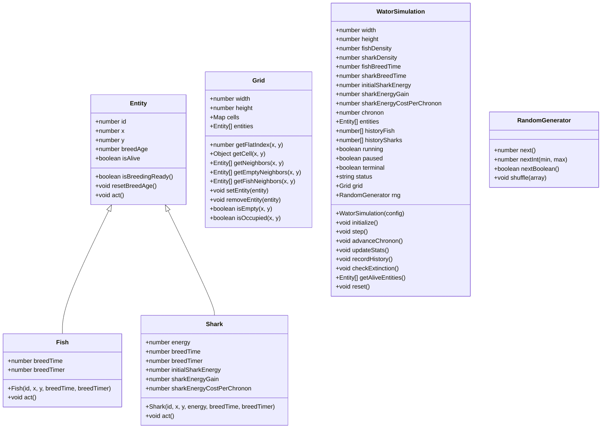
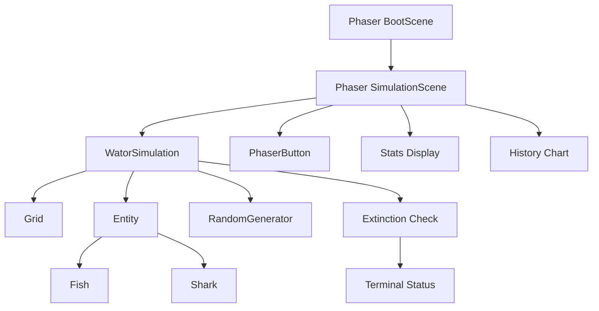
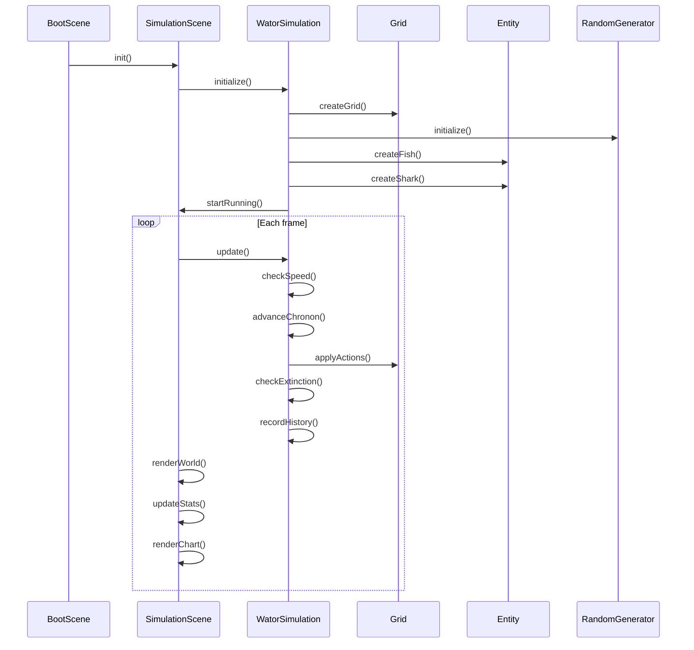

# Design: Wa-Tor Phaser Web App

## Architecture Overview

```
┌─────────────────────────────────────────────────────────────┐
│                      index.html                              │
│  Phaser CDN + ES2020 module loader + PWA manifest + sw.js    │
└─────────────────────────────────────────────────────────────┘
                              │
                              ▼
┌─────────────────────────────────────────────────────────────┐
│                   Phaser Game (BootScene → SimulationScene)  │
│  - Full-window Phaser-native rendering                       │
│  - Graphics-based world rendering (no sprites)               │
│  - Custom PhaserButton UI components                         │
└─────────────────────────────────────────────────────────────┘
                              │
                              ▼
┌─────────────────────────────────────────────────────────────┐
│              Simulation Engine (framework-independent)       │
│  WatorSimulation → Grid → Entity → Fish/Shark              │
│  - Toroidal grid with flat array + entity objects            │
│  - Simultaneous chronon updates                              │
│  - Single RNG for all random choices                         │
└─────────────────────────────────────────────────────────────┘
```

## Class Diagram



## Component Interaction Diagram



## Key Design Decisions

### 1. Flat Grid Array + Entity Objects (R3)

The grid uses a flat array where each slot holds either an entity ID (number) or an `empty` marker (null). Entity objects are stored separately in a list. This provides:

- O(1) cell access by flat index
- Entity objects carry full state (position, breed age, energy)
- The grid array and entity objects are kept consistent by the Grid class

### 2. Simultaneous Chronon Updates (R6)

Each chronon proceeds in two phases:

1. **Collection phase**: For each surviving entity (in randomized order), compute the action (move, eat, reproduce, die) and record it. Newborns and deaths are deferred.
2. **Application phase**: Apply all collected actions simultaneously. This ensures that entities born in the current chronon do not act, and entities that die before their turn are skipped.

### 3. Single Random Number Generator (R7)

A single `RandomGenerator` class serves the entire simulation. Every random choice—initialization, movement selection, turn-order shuffling—draws from this one source. This ensures reproducibility of random sequences and avoids scattered `Math.random()` calls.

### 4. Phaser Graphics Rendering (R8, R14)

All rendering uses Phaser `Graphics` drawing primitives:

- Empty water: background color
- Fish: green circle
- Sharks: blue circle (slightly larger than fish)
- No grid lines
- No per-cell sprites
- No movement animation

### 5. Phaser-Native UI (R9, R13)

All controls are Phaser `Graphics` + `Text` objects:

- `PhaserButton` component handles normal/hover/active/disabled/selected states
- Speed buttons in a horizontal row
- Action buttons (Play/Pause, Step, Reset) on separate rows
- Stats on the left, world in center, controls on right
- History chart across the bottom

### 6. Responsive Layout (R12)

The layout adapts to window size:

- Wide window: stats left, world center, controls right, chart bottom
- Narrow window (tablet): reflow while preserving world aspect ratio
- Browser resize triggers layout recomputation without changing grid dimensions

## Data Flow



## File Organization

```
index.html
src/
  main.js          — Entry point, Phaser game config
  config.js        — All tunable constants
  simulation/
    WatorSimulation.js   — Orchestrates chronons, stats, history
    Grid.js              — Toroidal grid, neighbor lookup, cell access
    Entity.js            — Base class (position, breed age, breeding readiness)
    Fish.js              — Fish behavior
    Shark.js             — Shark behavior
  scenes/
    BootScene.js         — Preload, layout setup
    SimulationScene.js   — World render, controls, stats, chart
  ui/
    PhaserButton.js      — Reusable button component
sw.js
manifest.webmanifest
assets/
  icon-192.png
  icon-512.png
```

## Constants (from PRD)

| Constant | Default |
|---|---|
| Grid width | 100 |
| Grid height | 70 |
| Fish density | 30% |
| Shark density | 5% |
| Fish breed time | 3 |
| Shark breed time | 25 |
| Initial shark energy | 5 |
| Shark energy gain | 3 |
| Shark energy cost per chronon | 1 |
| Speed | 10x |
| Supported speeds | 1x, 5x, 10x, 30x, 60x |
| History window | 500 chronons |
